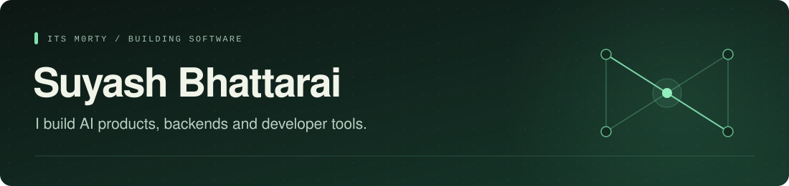

  

  <a href="https://www.suyashbhattarai.com.np/work">Portfolio</a>
  &nbsp;&nbsp;/&nbsp;&nbsp;
  <a href="mailto:hey@suyashbhattarai.com.np">Email</a>
  &nbsp;&nbsp;/&nbsp;&nbsp;
  <a href="https://github.com/pulls?q=is%3Apr+is%3Amerged+author%3AItsM0rty">Merged contributions</a>

I like building the whole thing; the interface, backend, agent loop and the checks that tell me when it breaks. Most of my work is in TypeScript, Python and Rust.

World 2nd and Country Topper in Computer Science (Cambridge Awards).

### Stack

  
  
  
  

  
  
  
  
  
  
  

### Selected projects

| Project | What I built | Explore |
| :--- | :--- | :--- |
| **Flamide** | An AI enquiry and CRM system, now in beta with select consultancies. The agent handles conversations, updates records and hands uncertain cases to a counselor. Next.js, TypeScript and Supabase. | Case study ([link](https://www.suyashbhattarai.com.np/work-flamide)) |
| **Entode** | A schema compiler and agent harness that generate FastAPI backends. It tests the running app with pytest and recursively feeds failures back into a bounded repair loop. | Case study ([link](https://www.suyashbhattarai.com.np/work-entode)) |
| **Evalgate** | A Rust evaluation runner for model outputs and tool responses, with latency and cost checks. Recorded responses let me rerun regression checks without another model call. | Case study ([link](https://www.suyashbhattarai.com.np/work-evalgate)) · Code ([link](https://github.com/ItsM0rty/evalgate)) |
| **Open Switch** | A Rust LLM gateway with provider fallbacks, circuit breakers, budgets and streamed responses. Its browser demo simulates routing decisions without calling a model. | Case study ([link](https://www.suyashbhattarai.com.np/work-openswitch)) · Code ([link](https://github.com/ItsM0rty/openswitch)) |

### Open source

I also contribute fixes to projects I use or want to understand better. A couple of merged C++ fixes cover numeric rounding in DuckDB's PostgreSQL connector ([link](https://github.com/duckdb/duckdb-postgres/pull/610)) and float parsing in libpqxx ([link](https://github.com/jtv/libpqxx/pull/1256)).

More projects and browser demos are on my portfolio ([link](https://www.suyashbhattarai.com.np/work)).
